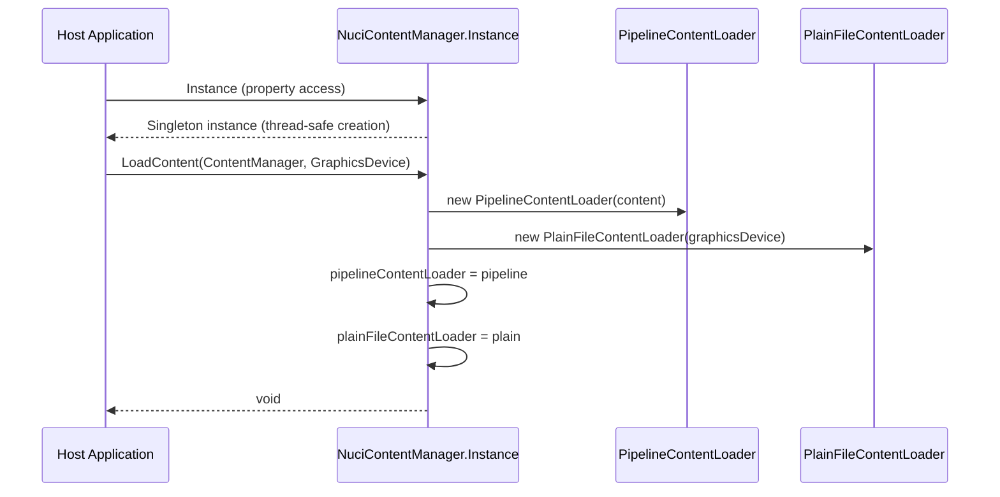

# Initialise Content Loading Flow

## Overview

This flow describes the initialisation sequence for the content loading subsystem. A consuming MonoGame application must call this before any asset loading operations.

## Sequence Diagram

## Steps

### 1. Singleton Access

**Code:** `NuciContentManager.Instance`

**Behaviour:**
- First access: creates instance via `volatile` double-checked locking with `Lock`
- Subsequent accesses: returns existing instance
- Thread-safe for instance creation only

**Location:** [`NuciContentManager.cs`](../NuciXNA.DataAccess/Content/NuciContentManager.cs#L35-L50)

### 2. Standard Initialisation

**Code:** `NuciContentManager.Instance.LoadContent(content, graphicsDevice)`

**Parameters:**
| Parameter | Type | Source |
|-----------|------|--------|
| `content` | `ContentManager` | Host's MonoGame `ContentManager` |
| `graphicsDevice` | `GraphicsDevice` | Host's MonoGame `GraphicsDevice` |

**Behaviour:**
1. Creates `new PipelineContentLoader(content)`
2. Creates `new PlainFileContentLoader(graphicsDevice)`
3. Assigns both to internal fields

**Location:** [`NuciContentManager.cs`](../NuciXNA.DataAccess/Content/NuciContentManager.cs#L75-L85)

### 3. Injection Initialisation (Alternative)

**Code:** `NuciContentManager.Instance.LoadContent(pipelineLoader, plainFileLoader)`

**Parameters:**
| Parameter | Type | Source |
|-----------|------|--------|
| `pipelineLoader` | `IContentLoader` | Host-provided implementation |
| `plainFileLoader` | `IContentLoader` | Host-provided implementation |

**Behaviour:**
- Assigns the exact instances provided by the host
- No validation, no wrapper creation
- Enables testing and custom asset sources

**Location:** [`NuciContentManager.cs`](../NuciXNA.DataAccess/Content/NuciContentManager.cs#L65-L73)

## Preconditions

- Host must have valid `ContentManager` and `GraphicsDevice` instances (for standard overload)
- Host must have valid `IContentLoader` implementations (for injection overload)

## Postconditions

- `pipelineContentLoader` and `plainFileContentLoader` fields are non-null
- Manager is ready to serve `LoadSoundEffect`, `LoadSpriteFont`, `LoadTexture2D` calls

## Failure Modes

| Failure | Behaviour |
|---------|-----------|
| `LoadContent` not called before load methods | `NullReferenceException` when dereferencing unset loader fields |
| `LoadContent` called multiple times | Last call wins — previous loaders replaced without disposal |
| Null arguments passed | `NullReferenceException` when loaders are used |

## Concurrency Notes

- Instance creation is thread-safe
- `LoadContent` is **not** thread-safe — concurrent calls may result in lost updates
- `MissingTexturePlaceholder` static property is **not** thread-safe

## Related Documentation

- [NuciContentManager API](../api-reference/nuci-content-manager.md)
- [Content Loading Component](../components/content-loading.md)
- [Load Asset Flow](./load-asset.md)
- [Concurrency and Scheduling](../concurrency-and-scheduling.md)