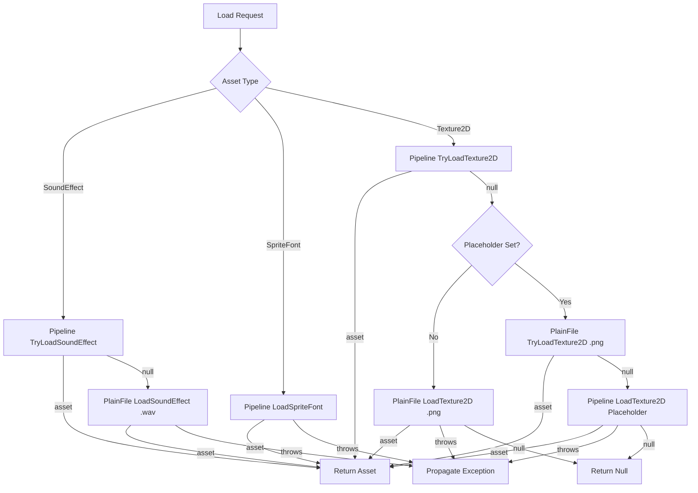

# Load Asset Flow

## Overview

This flow describes the asset loading process with fallback and placeholder policies for each supported asset type: `SoundEffect`, `SpriteFont`, and `Texture2D`.

## Flow Diagram

## Per-Asset-Type Policies

### SoundEffect

**Method:** `NuciContentManager.LoadSoundEffect(string contentPath)`

**Policy:** Pipeline optional → Plain-file required

| Step | Loader | Method | Path Transformation | Failure Behaviour |
|------|--------|--------|---------------------|-------------------|
| 1 | Pipeline | `TryLoadSoundEffect` | None | Exception → `null` |
| 2 | Plain-file | `LoadSoundEffect` | Append `.wav` | Exception → propagates |

**Returns:** `SoundEffect` (never `null` unless custom loader returns `null` on required load)

**Throws:** Plain-file loader exceptions if pipeline returns `null`

### SpriteFont

**Method:** `NuciContentManager.LoadSpriteFont(string contentPath)`

**Policy:** Pipeline required only

| Step | Loader | Method | Path Transformation | Failure Behaviour |
|------|--------|--------|---------------------|-------------------|
| 1 | Pipeline | `LoadSpriteFont` | None | Exception → propagates |

**Returns:** `SpriteFont`

**Throws:** Pipeline loader exceptions

**Note:** `PlainFileContentLoader.LoadSpriteFont` throws `NotImplementedException` and is never called by the manager.

### Texture2D

**Method:** `NuciContentManager.LoadTexture2D(string contentPath)`

**Policy:** Depends on `MissingTexturePlaceholder`

#### Without Placeholder (default)

| Step | Loader | Method | Path Transformation | Failure Behaviour |
|------|--------|--------|---------------------|-------------------|
| 1 | Pipeline | `TryLoadTexture2D` | None | Exception → `null` |
| 2 | Plain-file | `LoadTexture2D` | Append `.png` | Exception → propagates |

**Returns:** `Texture2D` or `null` (if plain-file required load returns `null`)

**Throws:** Plain-file loader exceptions if pipeline returns `null`

#### With Placeholder (set to non-null, non-empty, non-whitespace)

| Step | Loader | Method | Path Transformation | Failure Behaviour |
|------|--------|--------|---------------------|-------------------|
| 1 | Pipeline | `TryLoadTexture2D` | None | Exception → `null` |
| 2 | Plain-file | `TryLoadTexture2D` | Append `.png` | Exception → `null` |
| 3 | Pipeline | `LoadTexture2D` | `MissingTexturePlaceholder` value | Exception → propagates |

**Returns:** `Texture2D` or `null` (if placeholder pipeline load returns `null`)

**Throws:** Placeholder pipeline loader exceptions if both optional loads return `null`

## Path Handling

- **No normalisation:** Paths are forwarded exactly as provided — no trimming, case adjustment, or separator conversion
- **Plain-file suffixes:** `.wav` for `SoundEffect`, `.png` for `Texture2D` appended by `PlainFileContentLoader`
- **Placeholder path:** Used as-is, passed to pipeline loader

## Code Locations

| Flow Step | File | Method |
|-----------|------|--------|
| Pipeline TryLoad | `PipelineContentLoader.cs` | `Load*` (via `ContentLoader.TryLoad*`) |
| Plain-file Load | `PlainFileContentLoader.cs` | `Load*` |
| Plain-file TryLoad | `PlainFileContentLoader.cs` | `Load*` (via `ContentLoader.TryLoad*`) |
| Manager orchestration | `NuciContentManager.cs` | `LoadSoundEffect`, `LoadSpriteFont`, `LoadTexture2D` |

## Error Scenarios

| Scenario | Asset Type | Result |
|----------|------------|--------|
| Pipeline throws on TryLoad | SoundEffect, Texture2D | Suppressed, fallback attempted |
| Pipeline throws on Load | SpriteFont, Texture2D (placeholder) | Propagates to caller |
| Plain-file throws on Load | SoundEffect, Texture2D (no placeholder) | Propagates to caller |
| Plain-file throws on TryLoad | Texture2D (with placeholder) | Suppressed, placeholder attempted |
| Placeholder throws on Load | Texture2D (with placeholder) | Propagates to caller |
| All attempts return null | Texture2D (with placeholder) | Returns `null` |
| Loaders not initialised | All | `NullReferenceException` |

## Configuration Effects

| Setting | Effect on Texture2D Flow |
|---------|--------------------------|
| `MissingTexturePlaceholder = null` | Default: pipeline TryLoad → plain-file Load |
| `MissingTexturePlaceholder = ""` | Treated as absent: pipeline TryLoad → plain-file Load |
| `MissingTexturePlaceholder = " "` | Treated as absent: pipeline TryLoad → plain-file Load |
| `MissingTexturePlaceholder = "path"` | Pipeline TryLoad → plain-file TryLoad → pipeline Load(placeholder) |

## Tests

| Test File | Coverage |
|-----------|----------|
| `NuciContentManagerTests.cs` | All branches: pipeline success, plain-file fallback, placeholder enabled/disabled, empty/whitespace placeholder, path forwarding, exception propagation |

## Related Documentation

- [NuciContentManager API](../api-reference/nuci-content-manager.md)
- [IContentLoader Contract](../api-reference/icontent-loader.md)
- [Content Loading Component](../components/content-loading.md)
- [Error Handling](../error-handling.md)
- [Configuration](../configuration.md)