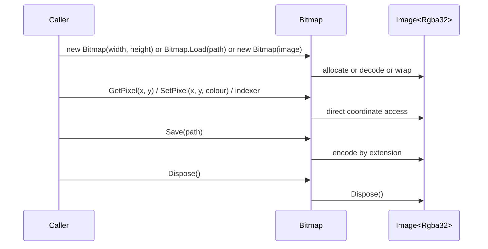

# Manipulate Bitmap Flow

## Overview

This flow describes the lifecycle of a `Bitmap` instance: creation, pixel access, saving, and disposal.

## Flow Diagram



## Lifecycle

### 1. Creation

| Constructor | ImageSharp Operation | Ownership |
|-------------|---------------------|-----------|
| `Bitmap(int width, int height)` | `new Image<Rgba32>(width, height)` | Bitmap owns |
| `Bitmap(Size2D size)` | Delegates to `Bitmap(int, int)` | Bitmap owns |
| `Bitmap(Image<Rgba32> sourceImage)` | None (wraps) | Caller owns, but `Dispose()` disposes |
| `Bitmap.Load(string fileName)` | `Image.Load<Rgba32>(fileName)` | Bitmap owns |

**Default pixel value:** All pixels initialised to transparent black (`Colour.FromArgb(0, 0, 0, 0)`)

### 2. Pixel Access

#### GetPixel

```csharp
Colour GetPixel(int x, int y)
{
    Rgba32 pixel = sourceImage[x, y];
    return Colour.FromArgb(pixel.A, pixel.R, pixel.G, pixel.B);
}
```

**Channel mapping:** `Rgba32(R, G, B, A)` → `Colour.FromArgb(A, R, G, B)`

#### SetPixel

```csharp
void SetPixel(int x, int y, Colour colour)
{
    sourceImage[x, y] = new Rgba32(colour.R, colour.G, colour.B, colour.A);
}
```

**Channel mapping:** `Colour(A, R, G, B)` → `Rgba32(R, G, B, A)`

#### Point2D Overloads

All coordinate-based methods have `Point2D` overloads that delegate to the integer-coordinate versions:
- `GetPixel(Point2D)` → `GetPixel(point.X, point.Y)`
- `SetPixel(Point2D, Colour)` → `SetPixel(point.X, point.Y, colour)`

#### Indexers

- `this[int x, int y]` → delegates to `GetPixel`/`SetPixel`
- `this[Point2D point]` → delegates to `GetPixel`/`SetPixel`

### 3. Save

```csharp
void Save(string fileName) => sourceImage.Save(fileName);
```

**Format inference:** ImageSharp infers the output format from the file extension.

### 4. Dispose

```csharp
void Dispose() => sourceImage.Dispose();
```

**Effect:** Disposes the wrapped `Image<Rgba32>`.

**Post-condition:** Bitmap must not be used after disposal.

**Idempotency:** Safe to call multiple times.

## Coordinate System

- **Origin:** Top-left corner `(0, 0)`
- **X-axis:** Horizontal, increasing rightward
- **Y-axis:** Vertical, increasing downward
- **Bounds:** Zero-based, delegated to ImageSharp
- **Out-of-bounds:** `IndexOutOfRangeException` from ImageSharp

## Channel Ordering Invariant

```
GetPixel:  Rgba32(R, G, B, A)  →  Colour.FromArgb(A, R, G, B)
SetPixel:  Colour(A, R, G, B)  →  Rgba32(R, G, B, A)
```

**Round-trip guarantee:** `SetPixel(x, y, colour)` followed by `GetPixel(x, y)` returns a `Colour` equal to the original.

## Error Scenarios

| Scenario | Behaviour |
|----------|-----------|
| Out-of-bounds coordinates | `IndexOutOfRangeException` from ImageSharp |
| `Load` with missing file | `FileNotFoundException` from ImageSharp |
| `Load` with unsupported format | `UnknownImageFormatException` from ImageSharp |
| `Save` with unsupported extension | `UnknownImageFormatException` from ImageSharp |
| Use after `Dispose` | `ObjectDisposedException` from ImageSharp |
| Invalid dimensions (negative/zero) | ImageSharp behaviour (typically throws) |

## Tests

| Test File | Coverage |
|-----------|----------|
| `BitmapTests.cs` | Construction dimensions, pixel round-trips, indexer equivalence, disposal without exception |

**Coverage gaps:**
- No tests for `Bitmap.Load`, `Bitmap.Save`
- No tests for invalid dimensions, invalid coordinates
- No tests for codec failure, post-disposal access
- No tests for ownership behaviour of wrapped image after `Dispose`

## Related Documentation

- [Bitmap API](../api-reference/bitmap.md)
- [Bitmap Access Component](../components/bitmap-access.md)
- [Error Handling](../error-handling.md)
- [NuciXNA.Primitives Types](https://github.com/hmlendea/nucixna.primitives)